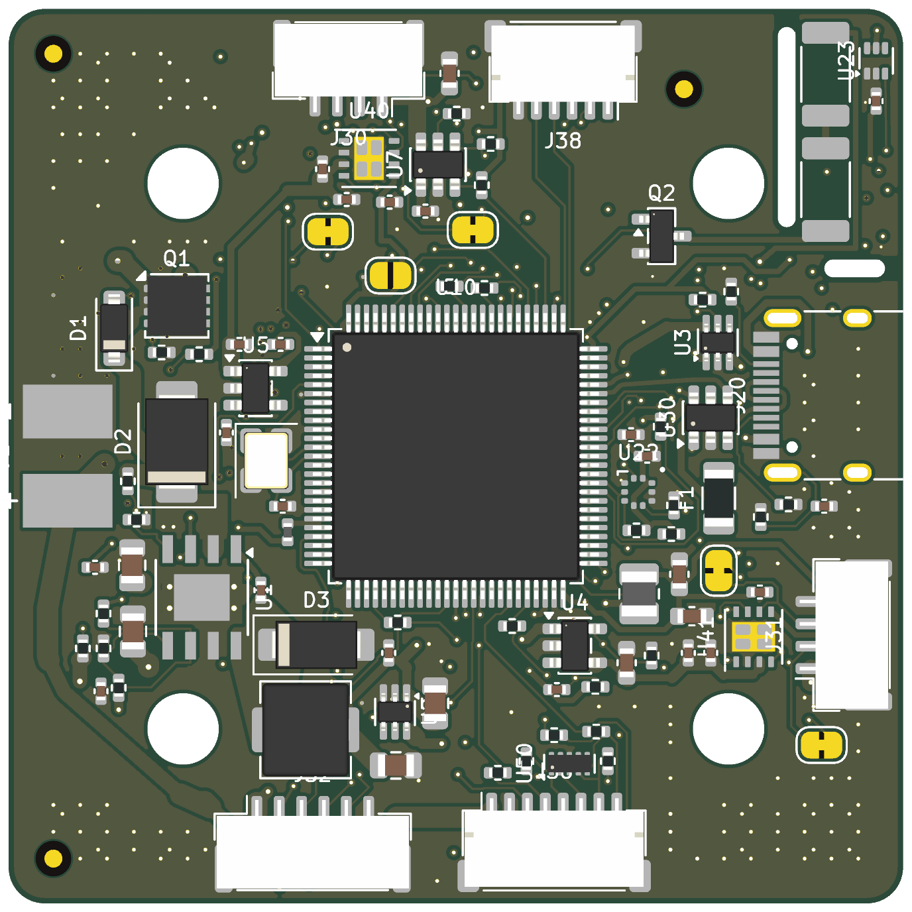
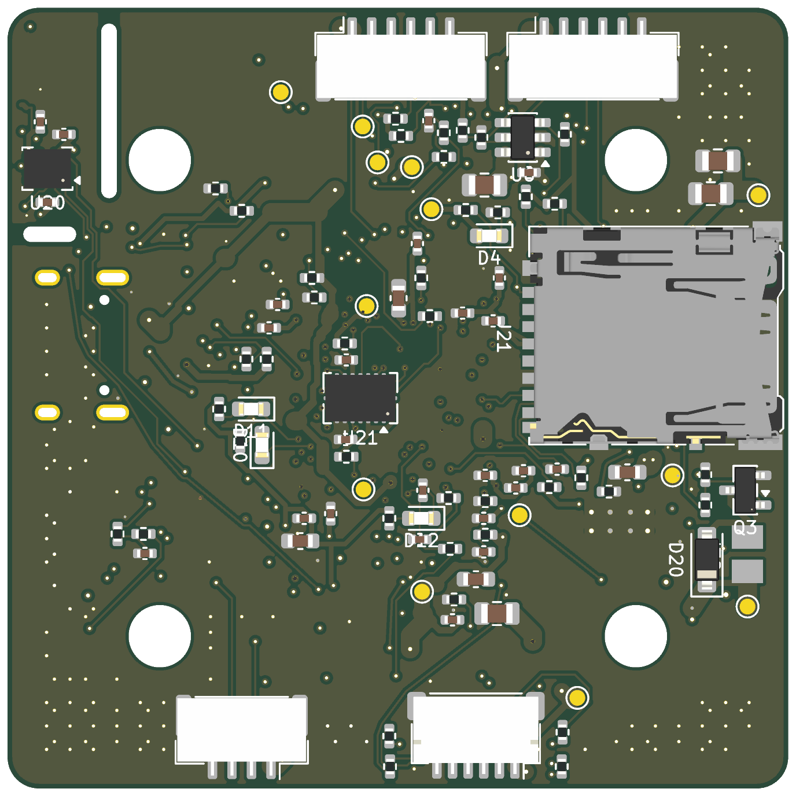

# fc-h743 — STM32H743 flight controller for a GPS-denied learned-control quadrotor

> **DRAFT UNTIL INDEPENDENT REVIEW.** Not yet reviewed by a second engineer and not ordered.
> Work through [REVIEW.md](REVIEW.md) before anyone pays for boards.

[](https://github.com/dvntekim/fc-h743/actions/workflows/hardware.yml)
· [Changelog](CHANGELOG.md) · [Build log](docs/BUILD_LOG.md) · [Design review](docs/design_review.md) · [Contributing](CONTRIBUTING.md)

**View it in the browser (no install):**
- Whole project (board + all 7 schematic sheets): <https://kicanvas.org/?github=https://github.com/dvntekim/fc-h743/tree/main/kicad>
- PCB only: <https://kicanvas.org/?github=https://github.com/dvntekim/fc-h743/blob/main/kicad/fc.kicad_pcb>
- PDF schematic: [docs/schematic.pdf](docs/schematic.pdf)

| Top | Bottom |
|---|---|
|  |  |

## What it is

A 50 × 50 mm, 6-layer flight controller (30.5 mm M3 mount) that runs PX4 on an STM32H743VIT6.
It is adapted from the Pixhawk FMUv6C reference design (same MCU family, LQFP-100, same PX4 pin
roles where possible) and built for indoor, GPS-denied flight with a learned (RAPTOR-style)
controller, so the electrical effort goes into clean sensing, timing and telemetry:

| Area | What is on the board | Why |
|---|---|---|
| Primary IMU | TDK ICM-45686 on SPI1, **clocked by a 32 kHz reference from TIM2_CH3 (PB10)**, on a thermally isolated corner island (rev B) | Locks the IMU's ODR to the MCU clock: no sample-rate drift between IMU and controller. PX4 `icm45686 -C 32000` |
| Second IMU | Bosch BMI088 on its own bus (SPI2), under the MCU | Vibration-robust accel; independent bus so one faulty sensor cannot stall the other |
| IMU thermal control | Slotted island (two 1 mm milled slots, 2.2 mm bridge), 2 × 12 Ω 2010 heater in series (1.08 W), AO3400A on PB9, TMP302A hardware cut-off at 60 °C | Holds the ICM-45686 at 51 °C so bias does not drift with ambient (PX4 `HEATER1_TEMP`); [docs/revB_thermal.md](docs/revB_thermal.md) |
| Barometer | Bosch BMP581 on I2C4 (0x47) | Lowest-noise MEMS baro in the class |
| CAN | 2 × TI TCAN1462V, CAN FD with signal improvement (8 Mbit/s) | DroneCAN/Cyphal sensors (flow, range) at FD rates |
| Motor outputs | 4 × bidirectional DShot on TIM1 + ESC serial telemetry (UART8) | RPM feedback for motor-aware learned control |
| Camera trigger | M7/M8 on TIM5 (capture/trigger) | Hardware timestamps for visual odometry |
| Power | TPS54360B 5.09 V buck (60 V in, switch node as a 26 mm² pour, boot loop 2.3 mm), ideal-diode OR with USB (2 × LM66100), TLV62569 3V3, LP5907 sensor LDO, 2 × TPS2553 current-limited switches | Sensor rail can be power-cycled from firmware (PB2) to recover a hung sensor |
| Storage / USB | microSD on SDMMC2 (4-bit), USB-C (FS) | Logs and parameters; PX4 console |

## What is real and what is simulated

Nothing on this page has been built. The board has passed every check that can run without
hardware: rule checks, a JLCPCB manufacturing check, field-solver, voltage-drop and thermal
models, a power-stage simulation, and PX4 booting on a simulated STM32H743 with this board's pin
map. Each model states its limits in its own file. The first built board must confirm the
numbers, starting with the bench plan in [REVIEW.md](REVIEW.md).

**Rev B (current, rev-B-draft1)** is laid out and checked. What is simulated and what is unbuilt:

| Claim | Basis | Status |
|---|---|---|
| ICM-45686 must be held within ±1.5 °C | datasheet drift and noise figures | derived, not measured |
| Rev A cannot hold any IMU temperature; rev B holds 45.6–57.8 °C | 2D thermal model of each routed board | **simulated** |
| PX4's heater loop holds 51 °C within ±0.55 °C | two-node model of the loop as coded in PX4 | **simulated**; fails below ~83 % of the modelled island isolation |
| TMP302 cuts the heater at 60 °C | TI datasheet strap table | unbuilt |
| Slots cost < 1.1 % impedance on adjacent tracks | atlc 2D field solver | simulated |
| IMU rotation `-R 14` | PX4 driver frame convention + footprint angle | unbuilt: tilt test on the bench |
| The board can be made | KiCad DRC with JLC rules (0 errors) | JLCDFM not yet run on rev B |

Nothing is ordered. The first built board must measure the island isolation (heater step, K/W) before
anything else; [docs/revB_thermal.md](docs/revB_thermal.md) has the bench plan.

## Verification status

| Check | Tool | Result |
|---|---|---|
| Electrical rules | KiCad 9 ERC | **0 errors, 0 warnings** |
| Design rules | KiCad 9 DRC (JLCPCB 6-layer limits, `kicad/fc.kicad_dru`) | **0 errors, 0 unconnected** (59 silkscreen-cosmetic warnings) |
| Schematic ↔ PCB parity | KiCad 9 DRC `--schematic-parity` | 0 issues |
| Vendor guides | every IC against its datasheet / layout guide | [docs/design_review.md](docs/design_review.md): 4 fixes made, 4 items open |
| Pin map | `scripts/pinmap_check.py` against ST's pin data (KiCad STM32H743VITx symbol) | **PASS**, 74 pins — [docs/pinmap.md](docs/pinmap.md) |
| BOM availability | JLCPCB parts API | rev A 69/69 in stock on 2026-11-06 — [docs/bom_check.md](docs/bom_check.md); rev B adds 3 lines (12 Ω 2010 checked: 7,000 in stock; TMP302A and 4.7 kΩ to re-check) |
| 5 V buck loop | ngspice averaged current-mode model | crossover 19–35 kHz, phase margin ≥ 66.6°, gain margin ≥ 13.1 dB over 27 corners; load step 4.78–5.39 V — [docs/power_sim.md](docs/power_sim.md) |
| Impedance and crosstalk | atlc 2D field solver + scan of the routed board | USB 84.7 Ω diff; worst crosstalk 1.1 %; track beside an island slot +1.1 % — `sim/si` |
| DC voltage drop | resistive-mesh solver on the routed copper | VBAT ≤ 56 mV at 3 A, +3V3 ≤ 46 mV; +5V to the 5 V switches 243 mV at their limits (open), heater 150 mV — `sim/pi` |
| Thermal | board conduction/convection model on the routed copper | rev A: no holdable IMU temperature; **rev B: 45.6–57.8 °C window, PX4 loop ±0.55 °C at 51 °C** — [docs/revB_thermal.md](docs/revB_thermal.md) |
| Firmware on the netlist | PX4 board port + Simantic STM32H743 simulator, scenario generated from the netlist | **PASS**: ICM-45686 on SPI1, BMI088 on SPI2, BMP581 on I2C4 @0x47, CAN1 RX, SD logger, NSH — [docs/verification.md](docs/verification.md) |
| Firmware build | PX4 at c0d2c54, GCC 13.2, Linux CI + macOS | builds, flash 91 % |
| Manufacturability | JLCDFM (JLCPCB online DFM) | rev A: 1 real finding fixed, other flags within JLC's limits — [docs/design_review.md](docs/design_review.md); **rev B not yet run**; PCBWay pending |
| Independent review | second engineer | **not done** |

## Board

- **Stackup:** JLCPCB JLC06161H-3313D, 1.6 mm, ENIG (layer thicknesses checked against jlcpcb.com/impedance).
  F.Cu signal · In1 GND · In2 signal · In3 signal · In4 GND · B.Cu signal.
  Every signal layer sits 0.18–0.25 mm from its own GND plane; In2/In3 face each other across
  0.545 mm. Written into the board file (`Board Setup → Physical Stackup`).
- **USB D+/D−:** 0.25 mm / 0.15 mm gap on F.Cu over In1 ≈ 90 Ω differential (IPC-2141 estimate;
  confirm with JLCPCB's impedance calculator). USB FS is forgiving at this length.
- **Net classes:** HighCurrent (VBAT, switch node) 0.8 mm · Power 0.4 mm · Supply (3V3, VDDA) 0.3 mm ·
  signals 0.127 mm / 0.1 mm clearance · vias 0.45/0.2 mm, plus 22 at 0.35/0.15 mm of which 16 are via-in-pad
  (order with epoxy-filled, capped vias — JLC includes this on 6-layer boards; confirm on the quote).
- **Parts on both sides.** The BMI088 sits on the bottom inside the MCU's pin ring; the ICM-45686 sits on
  the bottom of the island in the top-right corner, its heater on the top.
  Expected PX4 rotation `-R 14` (roll 180°, yaw 270°) for both — verify on the bench (REVIEW.md).
- **IMU island:** two 1 mm milled slots in Edge.Cuts, copper-free edge bridges, 2.2 mm corner bridge
  carrying 11 nets and the In1/In4 planes; 0.32 mm routing keepout beside each slot.

## Deviations from the spec doc (on purpose)

| Spec | Built | Reason |
|---|---|---|
| ≤ 38 × 38 mm | 50 × 50 mm | Courtyards alone filled 94 % of 38 × 38 with the frontier feature set (2 CAN FD, heater, two IMU buses, ideal-diode power path) |
| 4-layer | 6-layer | Two inner routing layers each next to a solid GND plane; needed to route LQFP-100 + both IMU buses at 50 × 50 |
| Top-side parts only | Both sides | IMUs under the MCU (short SPI, centroid placement); costs standard (not economic) assembly at JLCPCB |
| JLC04161H-3313 | JLC06161H-3313D | Follows from 6 layers |

## Repository

```
kicad/      KiCad 9 project (schematic, PCB, project library, DRC rules)
fab/        Gerber + drill zip, JLCPCB BOM and CPL, STEP
docs/       schematic PDF, renders, pin map, critical nets, power sim, design review, verification log,
            build log, BOM check, reports/
firmware/   PX4 board port: boards/dvntekim/fch743
sim/        simantic/ (PX4 boot scenario from the netlist), buck/ (ngspice), si/ (atlc field solver,
            crosstalk scan), pi/ (IR drop), thermal/ (board temperature)
scripts/    everything above is generated from these (design.py is the single source of truth)
.kibot/     KiBot config used by CI for the fab package, iBOM, PDF and STEP
.github/    CI workflow, issue and pull-request templates
REVIEW.md   checklist for the independent reviewer and for bring-up
CHANGELOG.md, CONTRIBUTING.md
```

How it was made: `scripts/design.py` (parts, nets, pin map) → `gen_lib.py` → `gen_sch.py` (schematic, ERC) →
`gen_pcb.py` (placement) → `prep_route.py` → Freerouting 1.9 → `import_ses.py`, then finishing passes
(`fix_route.py` local router, `stitch.py`/`island_fix.py` GND stitching, `rework_power.py`, `sw_zone.py`,
`vin_zone.py`) → `drc.sh` → `export.sh`. The schematic regenerates from `design.py`; after the hand-finishing,
**`kicad/fc.kicad_pcb` is the source of truth for the layout** (re-running `gen_pcb.py` starts a new layout).

## Licence

No licence has been chosen yet, so all rights are reserved by default. The owner is deciding
between CERN-OHL-S-2.0 (strongly reciprocal) and CERN-OHL-P-2.0 (permissive) for the hardware.

## Ordering

Do not order until REVIEW.md is signed off and CI is green on the commit being ordered. Then upload `fab/fc-h743-gerbers.zip` to JLCPCB
(6 layers, 1.6 mm, JLC06161H-3313D, ENIG), add assembly with `fab/bom_jlc.csv` and `fab/cpl_jlc.csv`,
and check every rotation in the placement preview.
