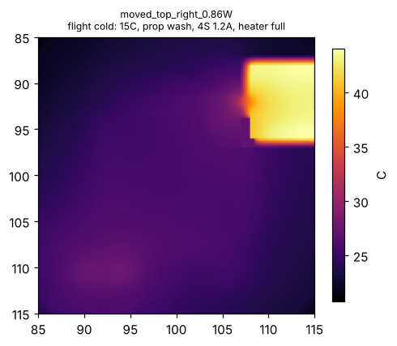
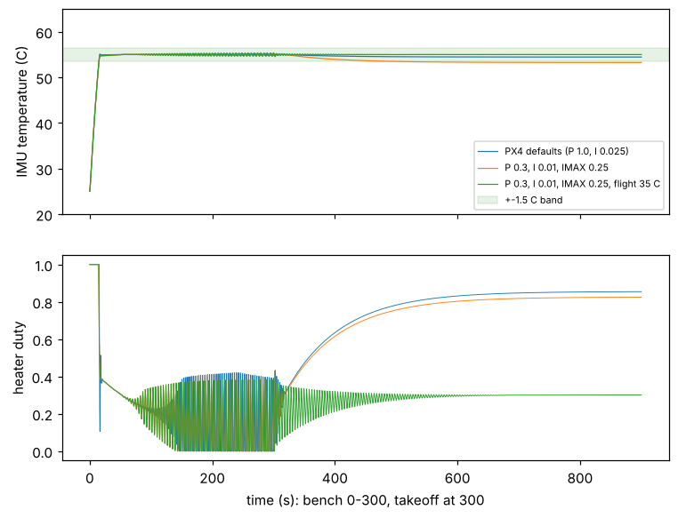

# Rev B: holding the IMUs at a set point

**Status: analysis complete, layout not started. Everything here is simulated; nothing is built.**

Rev A's thermal model showed the IMU heater cannot regulate (docs/design_review.md). This note
works out what the IMUs actually need, tests the obvious fixes in the same model, and picks the
rev B design. Scripts and raw results: `sim/thermal/revB/`.

## 1. Requirement: how tightly must the IMUs be held?

| Sensor | Bias drift (datasheet) | Noise (datasheet) | Drift reaches the noise floor after |
|---|---|---|---|
| ICM-45686 accel | ±0.15 mg/°C (board level) | 0.7 mg rms (100 Hz) | **4.7 °C** |
| ICM-45686 gyro | ±0.005 °/s/°C | 0.038 °/s rms (100 Hz) | 7.6 °C |
| BMI088 accel | < 0.2 mg/K | ~1.6 mg rms (160 µg/√Hz, 100 Hz) | ~8 °C |
| BMI088 gyro | ±0.015 °/s/K | 0.1 °/s rms (47 Hz) | 6.7 °C |

The ICM-45686 accelerometer is the tightest. **Requirement: hold the IMUs within ±1.5 °C**, so
temperature-driven bias stays at or below ~0.45 mg, under the sensor's own noise. It must hold over
the operating envelope:
- bench warm-up at 25 °C, still air (preflight);
- flight at 15 °C and 35 °C ambient, prop wash.

A 35 °C still-air bench at full 6S load is outside the envelope. There the board alone reaches
~80 °C under the MCU.

## 2. Island options (`island.py`)

Same board model as `sim/thermal/thermal.py`, plus:
- the MCU as its own node, coupled through its leads (~0.5 W/K) and the ~0.1 mm air gap under
  the body (~0.05 W/K);
- an island boundary that is either a **moat** (no pours or planes on any layer, tracks still
  cross) or a **slot** (routed cut-out) with two 1 mm bridges.

A set point is holdable when it is above every heater-off temperature and below every heater-full
temperature in the envelope. The width of that window is the figure of merit.

| Design | Heater | Bench 25 °C off / full | Flight 15 °C off / full | Flight 35 °C off / full | Holdable window |
|---|---|---|---|---|---|
| Rev A (IMUs under the MCU, no isolation) | 0.86 W | 51.3 / 68.8 | 22.3 / 29.0 | 47.3 / 54.0 | **none** (−22 °C) |
| Rev A | 1.5 W | 51.3 / 81.8 | 22.3 / 34.0 | 47.3 / 59.0 | none (−17 °C) |
| Slotted island in place, 11 × 9 mm | 0.86 W | 51.1 / 83.3 | 21.7 / 40.3 | 45.9 / 64.4 | none (−11 °C) |
| Slotted island in place | 1.5 W | 51.1 / 107 | 21.7 / 54.0 | 45.9 / 78.1 | 51.1–54.0 (2.9 °C) |
| **Island moved off the MCU (top right), slot, 10 × 8 mm** | **1.5 W** | 48.3 / 114 | 19.8 / 60.0 | 42.8 / 83.1 | **48.3–60.0 (11.8 °C)** |
| Island moved off the MCU (bottom right) | 1.5 W | 49.8 / 122 | 20.9 / 65.4 | 44.2 / 88.7 | 49.8–65.4 (15.6 °C) |

A copper-free moat in place gave almost nothing (heater lift 19 °C vs rev A's 18 °C in the hot
case). Under the MCU, the IMUs follow the MCU (~98 °C in the extreme hot case), whatever the island
does. Moving them out and adding heater power is what opens a usable window.

## 3. Control loop (`heater_loop.py`)

PX4's heater controller modelled as coded (`src/drivers/heater/heater.cpp`): PI on a 10 ms PWM period,
P 1.0 /°C, I 0.025 /°C per update, FF 0.05, integrator clamp ±0.25. Plant: island (0.3 J/K, 27–44 K/W
from the island model) plus a ~1 s heater-to-sensor lag. Scenario: 300 s bench warm-up, takeoff into
prop wash, 600 s flight.

| Case | Bench hold | Takeoff transient | Flight hold |
|---|---|---|---|
| PX4 defaults, 15 °C flight | ±0.22 °C | ±0.38 °C | 0.55 °C below set point (P carries what the clamped integrator cannot) |
| PX4 defaults, 35 °C flight | ±0.22 °C | ±0.16 °C | ±0.01 °C |
| Sensor lag ×3 | ±0.29 °C | ±0.38 °C | 0.55 °C |
| Island heat capacity ×2 or /2 | ±0.21 °C | ±0.38 °C | 0.55 °C |
| Island isolation ×2 better | ±0.16 °C | ±0.22 °C | ±0.13 °C |
| **Island isolation ×2 worse** | ±0.01 °C | 6.9 °C | **14.9 °C low: heater saturates** |

With the moved island, PX4's defaults hold the requirement at a 55 °C set point (PX4's default)
with margin. The one way it fails is if the island's thermal isolation is half what the model
predicts. That is the first number to measure on a built board (heater step, IMU temperature log).

## 4. Rev B design decision

1. **Move both IMUs off the MCU** onto a slotted island with two bridges that carry GND and the
   IMU nets. The top-right corner (between the MCU, the H2 mounting hole and USB-C) is the first
   candidate. Its layout constraints:
   - the slot must clear the H2 hole by ≥ 0.5 mm, so the island sits at y ≥ 88 mm;
   - the USB D+/D− pair must reroute around the island;
   - the +5V route that crosses this corner on B.Cu and In3 should become the direct trunk REVIEW.md
     already asks for.
2. **Heater 1.5 W.** Four 1206 parts at 0.38 W each would exceed their 0.25 W rating, so use 4 × 68 Ω
   in 1210/2010 (≥ 0.5 W each) or 8 × 1206 at ~0.19 W each. JLC stock to be checked.
3. **Set point 55 °C**, PX4 default heater gains.
4. **Over-temperature:** with the heater stuck on in still air the island reaches ~114 °C, above the
   IMUs' 85 °C operating limit. Rev B needs a hardware cut-off (thermistor + comparator, or a PTC in
   series with the heater) in addition to PX4's software limit.
5. Re-run ERC, DRC, atlc (the slot cuts the planes under the SPI lines that cross the bridges),
   IR drop and JLCDFM (slot-to-hole and slot-to-pad spacing).

## 5. Limits of these models
- 2D sheet model: the through-thickness gradient is ignored, and convection is a single
  coefficient per face (12 W/m²K still air, 50 W/m²K prop wash), not CFD.
- Air-gap and lead conductances for the MCU are textbook estimates, not measured.
- The control model is a two-node lumped plant. Its parameters come from the sheet model above,
  so its error compounds with that model's.
- Only a built board can confirm any of this. The bench plan: heater step response and island
  isolation (R), then a bench-to-flight temperature log against the ±1.5 °C requirement.
