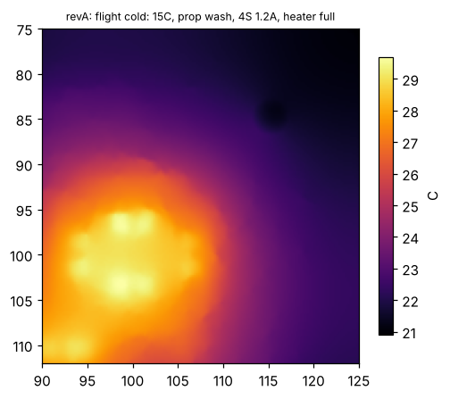
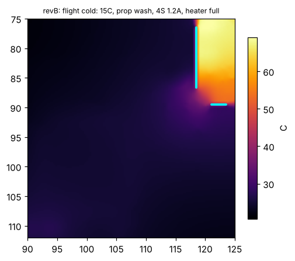

# Rev B: holding the IMU at a set point

**Status: rev B is laid out (rev-B-draft1) and every number below is re-run on the routed copper.
Everything here is simulated; nothing is built.**

Rev A's thermal model showed the IMU heater cannot regulate (docs/design_review.md). This note
works out what the IMUs actually need, tests the obvious fixes in the same model, picks the rev B
design, then checks the routed rev B board against rev A. Scripts and raw results:
`sim/thermal/revB/`.

**Result in one line:** rev A has no temperature it can hold in the operating envelope; rev B, as
routed, can hold the ICM-45686 anywhere in 45.6–57.8 °C, and PX4's own heater loop holds it within
±0.55 °C at 51 °C, as long as the built island's isolation is at least 83 % of the model's.

## 1. Requirement: how tightly must the IMUs be held?

| Sensor | Bias drift (datasheet) | Noise (datasheet) | Drift reaches the noise floor after |
|---|---|---|---|
| ICM-45686 accel | ±0.15 mg/°C (board level) | 0.7 mg rms (100 Hz) | **4.7 °C** |
| ICM-45686 gyro | ±0.005 °/s/°C | 0.038 °/s rms (100 Hz) | 7.6 °C |
| BMI088 accel | < 0.2 mg/K | ~1.6 mg rms (160 µg/√Hz, 100 Hz) | ~8 °C |
| BMI088 gyro | ±0.015 °/s/K | 0.1 °/s rms (47 Hz) | 6.7 °C |

The ICM-45686 accelerometer is the tightest. **Requirement: hold the IMUs within ±1.5 °C**, so
temperature-driven bias stays at or below ~0.45 mg, under the sensor's own noise. It must hold over
the operating envelope:
- bench warm-up at 25 °C, still air (preflight);
- flight at 15 °C and 35 °C ambient, prop wash.

A 35 °C still-air bench at full 6S load is outside the envelope. There the board alone reaches
~80 °C under the MCU.

## 2. Island options (`island.py`)

Same board model as `sim/thermal/thermal.py`, plus:
- the MCU as its own node, coupled through its leads (~0.5 W/K) and the ~0.1 mm air gap under
  the body (~0.05 W/K);
- an island boundary that is either a **moat** (no pours or planes on any layer, tracks still
  cross) or a **slot** (routed cut-out) with two 1 mm bridges.

A set point is holdable when it is above every heater-off temperature and below every heater-full
temperature in the envelope. The width of that window is the figure of merit.

| Design | Heater | Bench 25 °C off / full | Flight 15 °C off / full | Flight 35 °C off / full | Holdable window |
|---|---|---|---|---|---|
| Rev A (IMUs under the MCU, no isolation) | 0.86 W | 51.3 / 68.8 | 22.3 / 29.0 | 47.3 / 54.0 | **none** (−22 °C) |
| Rev A | 1.5 W | 51.3 / 81.8 | 22.3 / 34.0 | 47.3 / 59.0 | none (−17 °C) |
| Slotted island in place, 11 × 9 mm | 0.86 W | 51.1 / 83.3 | 21.7 / 40.3 | 45.9 / 64.4 | none (−11 °C) |
| Slotted island in place | 1.5 W | 51.1 / 107 | 21.7 / 54.0 | 45.9 / 78.1 | 51.1–54.0 (2.9 °C) |
| **Island moved off the MCU (top right), slot, 10 × 8 mm** | **1.5 W** | 48.3 / 114 | 19.8 / 60.0 | 42.8 / 83.1 | **48.3–60.0 (11.8 °C)** |
| Island moved off the MCU (bottom right) | 1.5 W | 49.8 / 122 | 20.9 / 65.4 | 44.2 / 88.7 | 49.8–65.4 (15.6 °C) |

A copper-free moat in place gave almost nothing (heater lift 19 °C vs rev A's 18 °C in the hot
case). Under the MCU, the IMUs follow the MCU (~98 °C in the extreme hot case), whatever the island
does. Moving them out and adding heater power is what opens a usable window.

### Corner island: bridge width and heater power

The top-right corner is the only place off the MCU with room (between H2, USB-C and the board
edge). Exact slot geometry: slot A x 118–119 mm, y 76–87.2 mm; slot B y 89–90 mm, x 120.6–124 mm,
both 1 mm milled (JLC's minimum for a non-plated slot). The two short edge bridges (top of slot A,
right end of slot B) are kept copper-free on every layer, so only FR4 crosses them. Everything
electrical crosses the corner bridge between the slot ends.

| Corner bridge (copper width) | Heater | Bench off / full | Flight 15 °C off / full | Flight 35 °C off / full | Holdable window |
|---|---|---|---|---|---|
| 3 mm | 1.1 W | 46.4 / 102.0 | 18.5 / 52.5 | 40.8 / 74.8 | 46.4–52.5 (6.2 °C) |
| **2.2 mm** | **1.1 W** | 46.2 / 107.4 | 18.4 / 56.1 | 40.6 / 78.3 | **46.2–56.1 (10.0 °C)** |
| 2.2 mm | 1.5 W | 46.2 / 129.7 | 18.4 / 69.8 | 40.6 / 92.1 | 46.2–69.8 (23.7 °C) |

1.5 W would give more margin, but two 2010 resistors (0.75 W each) are the most heater that fits
across a 5.2 mm island. 1.1 W keeps each resistor at 72 % of its rating.

## 3. Rev B as laid out

| | Rev A | Rev B |
|---|---|---|
| IMU position | both on B.Cu under the MCU, inside its pin ring | ICM-45686 (U20) on B.Cu of the corner island; BMI088 (U21) stays under the MCU |
| Isolation | none | two 1 mm milled slots, copper-free edge bridges, 2.2 mm corner bridge |
| Heater | 4 × 120 Ω 1206 around the IMUs, 0.86 W | 2 × 12 Ω 2010 **in series** on F.Cu of the island, 1.08 W (0.54 W each) |
| Set point | 45 °C | 51 °C |
| Over-temperature | PX4 software limit only | TMP302A on the island: open-drain OUT pulls the heater gate low at 60 °C (10 °C hysteresis), whatever the MCU does; 4.7 kΩ gate resistor lets it win |

Why the layout ended up like this:
- **Series heater, not parallel.** In parallel, the four heater pads along the island alternate
  +5V, LO, LO, +5V, so one of the two nets has to drop through a via into the inner layers, and
  the inner layers of the corner bridge were already full. In series (+5V, MID, MID, LO) both
  +5V and HEATER_LO leave the island on F.Cu with no via. Same 1.08 W, same 0.54 W per resistor.
- **Only the ICM-45686 is heated.** The island has room for one IMU with its decoupling and a
  GND path. With the BMI088 on it too, the BMI088's GND pads (in the column facing the board edge,
  between its CS and VDDIO pins) had no via room, and Bosch's footprint forbids copper under the
  part. The ±1.5 °C requirement comes from the ICM-45686 (section 1). The BMI088's drift reaches
  its noise floor after 6.7–8 °C, so it stays where rev A had it and relies on PX4's thermal
  calibration. In rev B it is the cross-check IMU, not the reference.
- **Corner bridge capacity.** 11 nets plus the In1/In4 GND planes cross it: F 2 (+5V, HEATER_LO),
  In2 3, In3 3, B 3 (`scripts/bridgecut.py`). With both IMUs on the island it was 18 and the
  autorouter could not finish. A 0.32 mm routing keepout around each slot
  (`scripts/slot_keepout.py`) keeps tracks at the fab's copper-to-edge clearance; the autorouter
  does not know that rule on its own.

## 4. Rev A vs rev B on the routed copper (`island_routed.py`)

Same solver as section 2, but the copper, the slots, the heater pads and the IMU pads all come
from each routed board (`scripts/export_geom.py`), not from masks.

| Case | Rev A IMU off / full | Rev B ICM-45686 off / full | Rev B heater lift |
|---|---|---|---|
| Bench 25 °C, still air, 4S 1.2 A | 51.3 / 68.8 | 45.6 / 112.3 | 66.7 °C |
| Flight 15 °C, prop wash, 4S 1.2 A | 22.3 / 29.0 | 18.1 / 57.8 | 39.6 °C |
| Flight 35 °C, prop wash, 6S 2.5 A | 47.3 / 54.0 | 40.2 / 79.9 | 39.6 °C |
| **Holdable window** | **none (−22.2 °C)** | **45.6–57.8 °C (12.1 °C)** | |

Isolation as routed: 61.8 K/W in still air, 36.7 K/W in prop wash (heater lift ÷ 1.08 W). The
routed island holds slightly better than the mask model (12.1 vs 10.0 °C window).

| Rev A, flight 15 °C, heater full | Rev B, flight 15 °C, heater full |
|---|---|
|  |  |

Heater stuck on in still air: the island reaches 112 °C in the model, above the IMU's 85 °C limit.
The TMP302 cuts the heater at 60 °C.

## 5. Control loop (`heater_loop.py`)

PX4's heater controller modelled as coded (`src/drivers/heater/heater.cpp`): PI on a 10 ms PWM
period, P 1.0 /°C, I 0.025 /°C per update, FF 0.05, integrator clamp ±0.25. Plant: island
(0.3 J/K) with the routed isolation above, plus a ~1 s heater-to-sensor lag. Scenario: 300 s bench
warm-up at 25 °C, takeoff into prop wash, 600 s flight. Set point 51 °C, heater 1.08 W.

| Case | Bench hold | Takeoff transient | Flight hold | Flight duty |
|---|---|---|---|---|
| PX4 defaults, 15 °C flight | ±0.18 °C | 0.34 °C | 0.52 °C low | 81 % |
| PX4 defaults, 35 °C flight | ±0.18 °C | 0.21 °C | ±0.03 °C | 27 % |
| Sensor lag ×3 | ±0.27 °C | 0.34 °C | 0.52 °C low | 81 % |
| Island heat capacity ×2 or ÷2 | ≤ ±0.16 °C | 0.34 °C | 0.52 °C low | 81 % |
| Island isolation ×2 better | ±0.12 °C | 0.19 °C | 0.11 °C low | 41 % |
| Island isolation ×0.85 | ±0.18 °C | 0.45 °C | 0.66 °C low | 95 % |
| **Island isolation ×0.75** | ±0.18 °C | 0.55 °C | **3.1 °C low: heater saturates** | 100 % |
| Island isolation ×0.5 | ±0.07 °C | 5.0 °C | 13.0 °C low | 100 % |

The 15 °C flight case is the limit: the heater needs 81 % duty there, and the clamped integrator
leaves a 0.5 °C steady error that P carries. Below ~83 % of the modelled isolation the heater
saturates in that case. Fallbacks if a built board measures worse: lower the set point toward
the 45.6 °C bench floor (each °C lower tolerates ~2.5 % less isolation), or accept the error in cold
flight and let PX4's thermal calibration cover it.

## 6. What the slots touch elsewhere

| Check | Result |
|---|---|
| ERC / DRC / parity | 0 errors · 0 errors, 0 unconnected · 0 |
| Impedance next to a slot (`sim/si/slot_edge.py`, atlc) | track at the 0.32 mm keepout limit: In2 71.8 Ω vs 71.0 Ω far from the slot; F.Cu 73.4 vs 72.7 Ω. ≤ 1.1 %, negligible |
| +5V drop (`sim/pi`) | heater 0.21 A on the long +5V route: TPS2553 inputs 243 / 173 mV at their limits (rev A 235 / 167 mV); heater pad 150 mV low, so 1.02 W instead of 1.08 W |
| Slot to H2 mounting hole | 0.75 mm (slot A edge to hole edge) |
| JLCDFM on the rev B Gerbers | see docs/design_review.md |

## 7. Limits of these models
- 2D sheet model: the through-thickness gradient is ignored, and convection is a single
  coefficient per face (12 W/m²K still air, 50 W/m²K prop wash), not CFD.
- Air-gap and lead conductances for the MCU are textbook estimates, not measured.
- The control model is a two-node lumped plant. Its parameters come from the sheet model above,
  so its error compounds with that model's.
- The 1 mm slot is cut by the fab's router, so its real width and corner radius vary; the model
  treats it as an ideal 1 mm cut.
- Only a built board can confirm any of this. The bench plan: heater step response and island
  isolation (K/W, still air and with a fan), then a bench-to-flight temperature log against the
  ±1.5 °C requirement.
